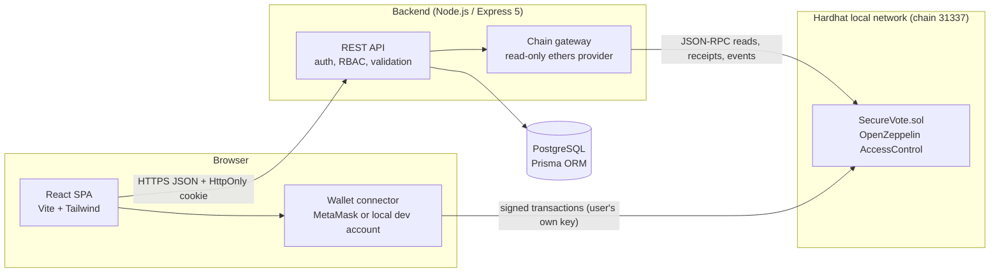
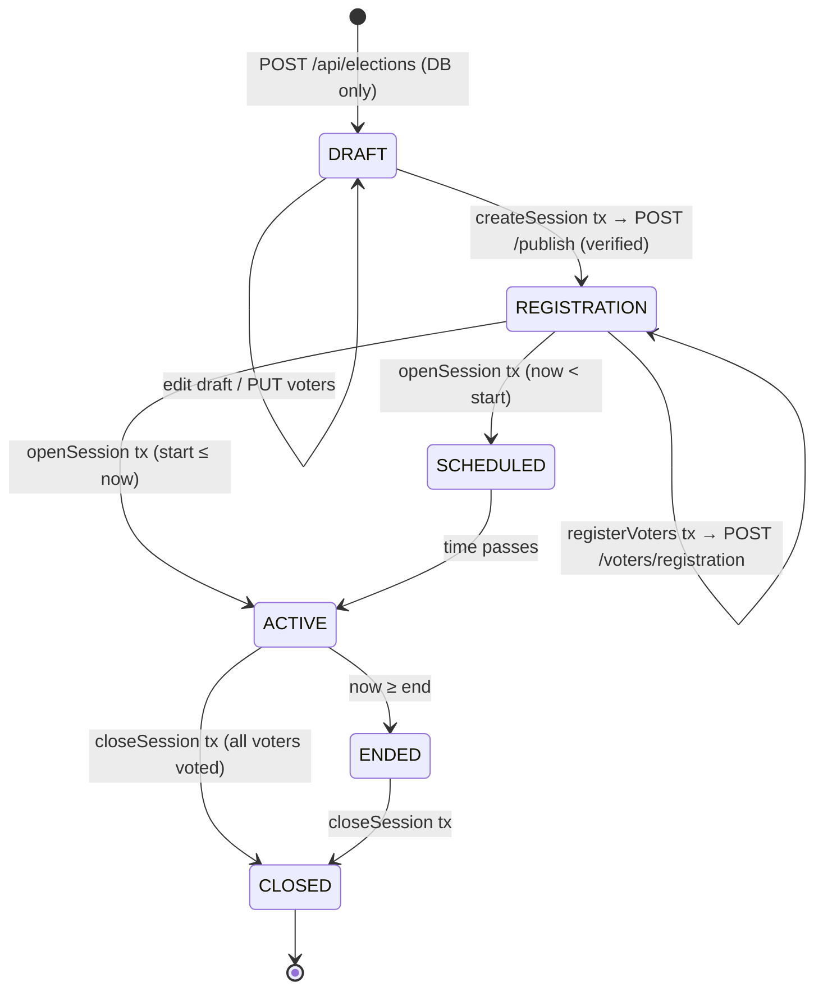

# SecureVote — Architecture

> Educational prototype on a local Hardhat network with synthetic data. Not a real product.

## 1. System overview



**Key design decision — users sign their own transactions.** The backend holds **no private keys**. Every on-chain write (create session, register voters, open, vote, close, grant/revoke organizer) is signed in the browser by the acting user's own wallet. The frontend then sends only the **transaction hash** to the backend, which fetches the receipt from the node, verifies sender, target contract, status and the expected event, and only then updates its off-chain records. Consequences:

- A compromised backend cannot cast votes, create sessions or change results.
- The contract's access control is a real security boundary, not a duplicate of the API.
- The API can never "impersonate" a shareholder.

## 2. Repository layout

```
securevote/
├─ apps/
│  ├─ backend/            Express 5 API, Prisma schema/migrations/seed, Vitest + Supertest
│  │  ├─ prisma/          schema.prisma, migrations/, seed-data.ts, seed.ts
│  │  ├─ scripts/         demo-scenario.ts (+ API client, dev signer helpers)
│  │  ├─ src/
│  │  │  ├─ config/env.ts          environment validation (Zod)
│  │  │  ├─ lib/chain.ts           read-only blockchain gateway (ethers v6)
│  │  │  ├─ middleware/            auth session, CSRF, request context, error handler
│  │  │  ├─ routes/                auth, elections, organizations, audit, admin, system
│  │  │  ├─ services/              access control, elections DTO, tx verification, audit, verification
│  │  │  └─ validation/schemas.ts  request schemas (mirror contract limits)
│  │  └─ test/            unit, API and on-chain integration tests
│  └─ frontend/           React 19 SPA, Vitest + RTL, Playwright E2E
│     ├─ src/lib/         api client, auth, wallet, tx flow, contract error decoding, CSV
│     ├─ src/components/  UI kit, app shell, vote panel, results view, tx status …
│     ├─ src/pages/       landing, login, dashboard, elections, detail, organizer, results, audit, settings
│     └─ e2e/             full-workflow browser test
├─ packages/contracts/    Hardhat project: SecureVote.sol, tests, deploy script, exported ABI
├─ docs/                  architecture, security, API, finance, risks, legal notes, demo script
├─ scripts/               dev.mjs (one-command stack), e2e.mjs, check-secrets.mjs
└─ docker-compose.yml     PostgreSQL 16 for local development
```

## 3. Component responsibilities

| Component          | Responsibilities                                                                                                                                                                                                                                                       | Not responsible for                                                 |
| ------------------ | ---------------------------------------------------------------------------------------------------------------------------------------------------------------------------------------------------------------------------------------------------------------------- | ------------------------------------------------------------------- |
| **SecureVote.sol** | Roles (`DEFAULT_ADMIN_ROLE`, `ORGANIZER_ROLE`); session lifecycle; per-session voter registry and weights; one vote per voter; time window; weighted tallies; quorum; events                                                                                           | Identity of people, descriptions, notifications, privacy            |
| **Backend API**    | Demo authentication (bcrypt, server-side sessions); organization membership and roles; election drafts and eligibility lists; verification of user-signed transactions; results/audit APIs that read the chain; application audit log; rate limiting, CSRF, validation | Signing transactions; storing vote totals                           |
| **PostgreSQL**     | Users, organizations, memberships, election metadata, options, eligibility lists, tx references, audit events                                                                                                                                                          | Authoritative voting state                                          |
| **Frontend**       | Dashboards and forms; wallet connection; building and sending transactions; honest tx status; results charts; audit report export                                                                                                                                      | Security decisions (all checks are repeated server-side / on-chain) |
| **Hardhat node**   | Local EVM chain 31337 with public test accounts; JSON-RPC for browser and backend                                                                                                                                                                                      | Anything in production                                              |

## 4. On-chain vs. off-chain data

| Data                                                               | Location       | Reason                                                 |
| ------------------------------------------------------------------ | -------------- | ------------------------------------------------------ |
| Session title, option labels, start/end, quorum, organizer address | **On-chain**   | Rules must be fixed and publicly verifiable            |
| Voter addresses and weights per session                            | **On-chain**   | Eligibility and weighting are enforced by the contract |
| Votes (voter, option, weight) and totals                           | **On-chain**   | Authoritative counting; auditability                   |
| Lifecycle state (Created/Open/Closed)                              | **On-chain**   | State machine enforced by the contract                 |
| Names, e-mails, password hashes, sessions                          | Off-chain (DB) | Personal data must not be published or immutable       |
| Organization details, share counts, description text               | Off-chain (DB) | Business metadata; may contain sensitive details       |
| Draft elections and the prepared eligibility list                  | Off-chain (DB) | Editable before publication                            |
| Transaction references and their status                            | Off-chain (DB) | Links app actions to chain transactions                |
| Application audit log (logins, drafts, verifications)              | Off-chain (DB) | Operational accountability; **no ballot choices**      |

The database deliberately has **no column for vote totals or per-voter choices**, so there is no second copy that could disagree with the contract.

## 5. Election lifecycle and data flow



`DRAFT` is a database status. Every other status is **derived live from the contract** (`state`, `startTime`, `endTime`) each time an election is read (`services/verification.ts → deriveStatus`).

### Recording a user-signed transaction (all lifecycle steps and votes)

1. Frontend builds the call (e.g. `castVote(sessionId, option)`), the user's wallet signs it, the node mines it.
2. The UI waits for the receipt (`mining`), then calls e.g. `POST /api/elections/:id/votes { txHash }` (`recording`).
3. Backend (`services/transactions.ts`): fetch tx + receipt from the node → check `to == contract`, `from == user's linked wallet`, `status == 1` → parse events → route-specific checks (e.g. `VoteCast.voter == wallet && sessionId matches`, or `SessionCreated` fields equal the draft).
4. Backend stores a `TransactionReference` (`PENDING` / `CONFIRMED` / `FAILED`) and an `AuditEvent`, then responds.
5. The UI shows "Transaction confirmed" only after step 4 succeeded; if step 4 fails it shows "Confirmed on-chain — not yet recorded" with a retry button.

## 6. Consistency between database and blockchain

| Situation                                                        | Handling                                                                                          |
| ---------------------------------------------------------------- | ------------------------------------------------------------------------------------------------- |
| Tx mined, API call failed (network)                              | UI phase `recordFailed` + "Retry recording"; re-submitting the same hash is idempotent            |
| Tx reverted                                                      | Recorded as `FAILED`, UI shows decoded contract error; nothing reported as success                |
| Tx confirmed but does not match the draft (e.g. different title) | `CONFIG_MISMATCH`, recorded as `FAILED`, draft stays unpublished                                  |
| Someone submits another user's tx hash                           | `TX_SENDER_MISMATCH` (403); hashes are unique per user/kind/election                              |
| Voters registered on-chain that are not on the DB list           | Accepted (chain is authoritative) but logged as `CHAIN_DB_MISMATCH`                               |
| Hardhat node restarted (chain wiped)                             | Elections show `CHAIN_MISSING`; health check explains; `npm run dev:fresh` redeploys and re-seeds |
| Node unreachable                                                 | `CHAIN_UNAVAILABLE` status, 503 errors with a hint; no stale totals displayed                     |

The auditor page performs two automated checks: **configuration** (DB draft vs. on-chain session) and **totals** (independent recount of `VoterRegistered`/`VoteCast` events vs. contract storage).

## 7. Authentication and authorization

- Demo login with e-mail + password (bcrypt). A random 256-bit token is stored in an `HttpOnly; SameSite=Strict` cookie; only its SHA-256 hash is stored in `AuthSession`.
- Every request reloads the user's memberships from the database; roles in the request body are never trusted.
- Roles are **per organization** (`OrganizationMembership.roles`), so one person can be a shareholder in one organization and have no access to another.
- Contract roles mirror the critical permissions: `ORGANIZER_ROLE` (granted by the admin with a signed transaction that the backend verifies before updating the DB role) and the per-session organizer.

| Action                    | Off-chain rule (API)                                           | On-chain rule (contract)                                          |
| ------------------------- | -------------------------------------------------------------- | ----------------------------------------------------------------- |
| Create draft              | `ORGANIZER` in the organization                                | —                                                                 |
| Publish (`createSession`) | owner organizer                                                | `ORGANIZER_ROLE`                                                  |
| Register voters           | owner organizer, voters must be org shareholders with wallets  | session organizer **and** `ORGANIZER_ROLE`, state `Created`       |
| Open                      | owner organizer                                                | session organizer **and** `ORGANIZER_ROLE`, ≥ 1 voter, before end |
| Vote                      | on the eligibility list                                        | registered for this session, not voted, `Open`, inside window     |
| Close                     | owner organizer or org admin                                   | session organizer or admin; after end **or** all voted            |
| Grant/revoke organizer    | org `ADMIN`; auditors cannot be granted (separation of duties) | `DEFAULT_ADMIN_ROLE`                                              |
| Results                   | any member who can see the election                            | `getResults` only when `Closed`                                   |
| Audit data, voter list    | admin, auditor, organizer                                      | public events                                                     |

## 8. Technology versions (as installed)

| Area      | Package                                  | Version                     |
| --------- | ---------------------------------------- | --------------------------- |
| Runtime   | Node.js                                  | 22.22 (≥ 20.19 required)    |
| Contracts | Hardhat / hardhat-toolbox                | 2.29.1 / 6.1.2              |
|           | Solidity (solc-js)                       | 0.8.28 (EVM target: cancun) |
|           | OpenZeppelin Contracts                   | 5.6.1                       |
|           | ethers                                   | 6.17.0                      |
| Backend   | Express / Prisma / Zod                   | 5.3.0 / 6.19.3 / 4.6.7      |
|           | helmet / express-rate-limit / bcryptjs   | 8.3.0 / 8.7.1 / 3.0.3       |
| Database  | PostgreSQL                               | 16                          |
| Frontend  | React / React Router / Vite              | 19.3.1 / 7.18.4 / 8.3.5     |
|           | Tailwind CSS / TanStack Query / Recharts | 4.3.3 / 5.104.5 / 3.10.1    |
|           | React Hook Form / @hookform/resolvers    | 7.90.0 / 5.9.2              |
| Testing   | Vitest / Testing Library / Playwright    | 4.1.12 / 16.3.3 / 1.56.1    |
| Tooling   | TypeScript / ESLint / Prettier / solhint | 5.9.3 / 10 / 3 / 6          |

Hardhat 2 (maintained under the `hh2` tag) was chosen over Hardhat 3 because its CommonJS configuration, `hardhat-toolbox` and documentation are the most widely used in course material. The compiler is the official `solc` npm package (pinned), so compiling needs no download from `binaries.soliditylang.org`.

## 9. Ports and startup order

| Service                        | Port             | Started by                                       |
| ------------------------------ | ---------------- | ------------------------------------------------ |
| PostgreSQL                     | 5432             | `npm run db:up` (Docker) or a local installation |
| Hardhat node                   | 8545             | `npm run chain:node`                             |
| Backend API                    | 4000 (127.0.0.1) | `npm run dev:backend`                            |
| Frontend (dev)                 | 5173             | `npm run dev:frontend` (proxies `/api` → 4000)   |
| Frontend (preview build)       | 4173             | `npm run preview:frontend`                       |
| Hardhat node for backend tests | 8546             | started automatically by the test setup          |

Order: PostgreSQL → Hardhat node → deploy contract → migrate + seed DB → backend → frontend → (optional) demo scenario. `npm run dev` performs all steps.
