# SecureVote — Primary Voting Workflow (Sequence Diagram)

> Educational prototype · local Hardhat network · synthetic participants.

The diagram shows the main authorization checks, the vote transaction, the rejected duplicate vote and the final result verification. "Wallet" is the acting user's own local test wallet (MetaMask or the local node's unlocked dev account); the backend never signs.

```mermaid
sequenceDiagram
    autonumber
    actor O as Organizer
    actor S as Shareholder
    actor A as Auditor
    participant FE as Frontend (React)
    participant BE as Backend API (Express)
    participant DB as PostgreSQL
    participant SC as SecureVote contract
    participant BC as Local blockchain (Hardhat 31337)

    rect rgb(30, 41, 59)
    note over O,BC: 1. Preparation (off-chain draft)
    O->>FE: Sign in (demo account)
    FE->>BE: POST /api/auth/login
    BE->>DB: verify bcrypt hash, create session
    BE-->>FE: HttpOnly SameSite=Strict cookie
    O->>FE: Create draft (title, options, schedule, quorum)
    FE->>BE: POST /api/elections (CSRF header)
    BE->>BE: Zod validation + role ORGANIZER in organization?
    BE->>DB: insert Election (DRAFT) + options
    O->>FE: Select eligible shareholders + weights
    FE->>BE: PUT /api/elections/:id/voters
    BE->>BE: owner? draft? voters are org shareholders with wallets?
    BE->>DB: replace VoterEligibility rows
    end

    rect rgb(30, 41, 59)
    note over O,BC: 2. Publication and registration (user-signed)
    O->>FE: "Sign and publish"
    FE->>SC: createSession(title, options, start, end, quorum) signed by organizer wallet
    SC->>SC: hasRole(ORGANIZER_ROLE)? 2..10 options? valid schedule?
    SC->>BC: store session, emit SessionCreated
    FE->>BE: POST /publish {txHash}
    BE->>BC: getTransaction + receipt
    BE->>BE: to == contract? from == organizer wallet? status == 1? config == draft?
    BE->>DB: Election → PUBLISHED, TransactionReference CONFIRMED, AuditEvent
    O->>FE: "Register voters"
    FE->>SC: registerVoters(id, addresses, weights)
    SC->>SC: session organizer + role? state Created? weight > 0? no duplicates?
    SC->>BC: emit VoterRegistered × n
    FE->>BE: POST /voters/registration {txHash} → verify events vs DB list
    O->>FE: "Open voting"
    FE->>SC: openSession(id)
    SC->>SC: organizer? Created? ≥1 voter? before end?
    SC->>BC: state Open (registration frozen), emit SessionOpened
    FE->>BE: POST /open {txHash} → verify SessionOpened
    end

    rect rgb(30, 41, 59)
    note over S,BC: 3. Voting
    S->>FE: Open election page
    FE->>BE: GET /api/elections/:id/eligibility
    BE->>DB: eligibility row for this user?
    BE->>SC: getVoter(id, wallet) → registered, weight, hasVoted
    BE-->>FE: canVote = true, weight
    S->>FE: Choose option, confirm (transparent-ballot warning)
    FE->>SC: castVote(id, option) signed by shareholder wallet
    SC->>SC: Open? start ≤ now < end? registered? not voted? valid option?
    SC->>BC: hasVoted = true, tally += weight, emit VoteCast
    FE->>FE: wait for receipt (status: mining)
    FE->>BE: POST /votes {txHash}
    BE->>BE: from == shareholder wallet? VoteCast for this session & voter?
    BE->>DB: TransactionReference CONFIRMED, AuditEvent (no ballot choice)
    BE-->>FE: CONFIRMED → UI shows "Transaction confirmed"
    end

    rect rgb(60, 20, 30)
    note over S,BC: 4. Duplicate vote is rejected
    S->>FE: "Try to vote again"
    FE->>SC: castVote(id, option) (gas estimation)
    SC-->>FE: revert AlreadyVoted(id, voter)
    FE-->>S: "Duplicate vote rejected" (nothing recorded)
    end

    rect rgb(30, 41, 59)
    note over O,BC: 5. Closing and results
    O->>FE: "Sign and close"
    FE->>SC: closeSession(id)
    SC->>SC: organizer or admin? Open? (now ≥ end OR all voted)?
    SC->>BC: state Closed, emit SessionClosed
    FE->>BE: POST /close {txHash} → verify SessionClosed
    S->>FE: View results
    FE->>BE: GET /results
    BE->>SC: getResults(id) (only when Closed)
    BE->>BC: getLogs(VoterRegistered, VoteCast) → independent recount
    BE-->>FE: weighted totals, turnout, quorum, outcome, recount matches = true
    end

    rect rgb(30, 41, 59)
    note over A,BC: 6. Audit
    A->>FE: Audit page
    FE->>BE: GET /audit (role ADMIN/AUDITOR/ORGANIZER)
    BE->>BC: all session events + timestamps
    BE->>DB: AuditEvents, TransactionReferences
    BE-->>FE: config DB vs chain, totals contract vs recount, event log
    A->>FE: Export JSON / CSV report
    end
```

